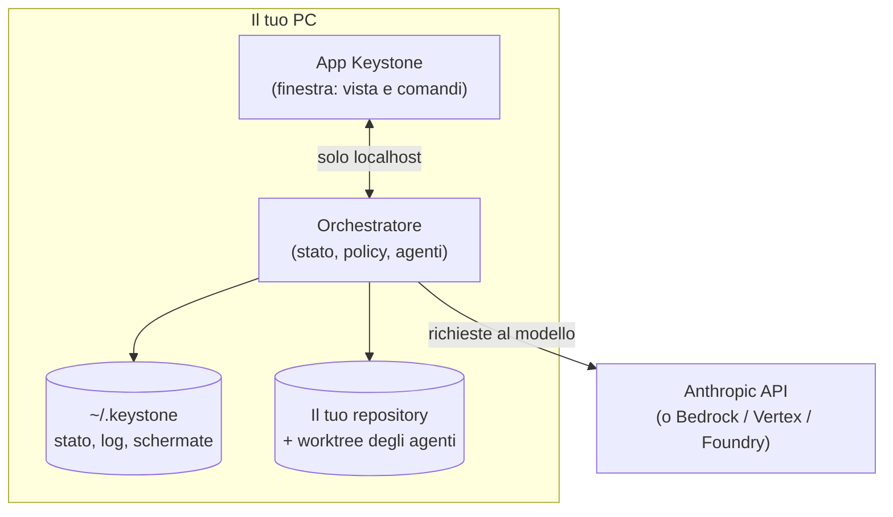
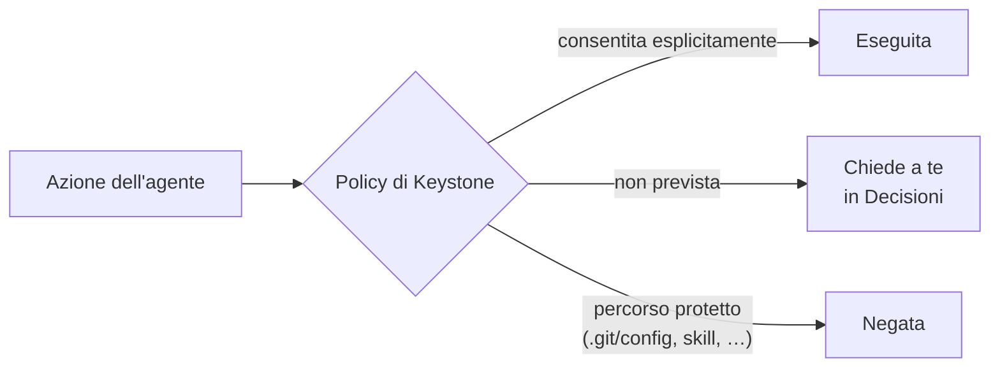
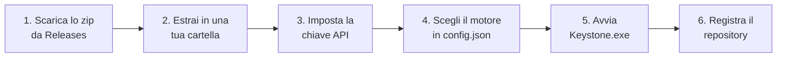
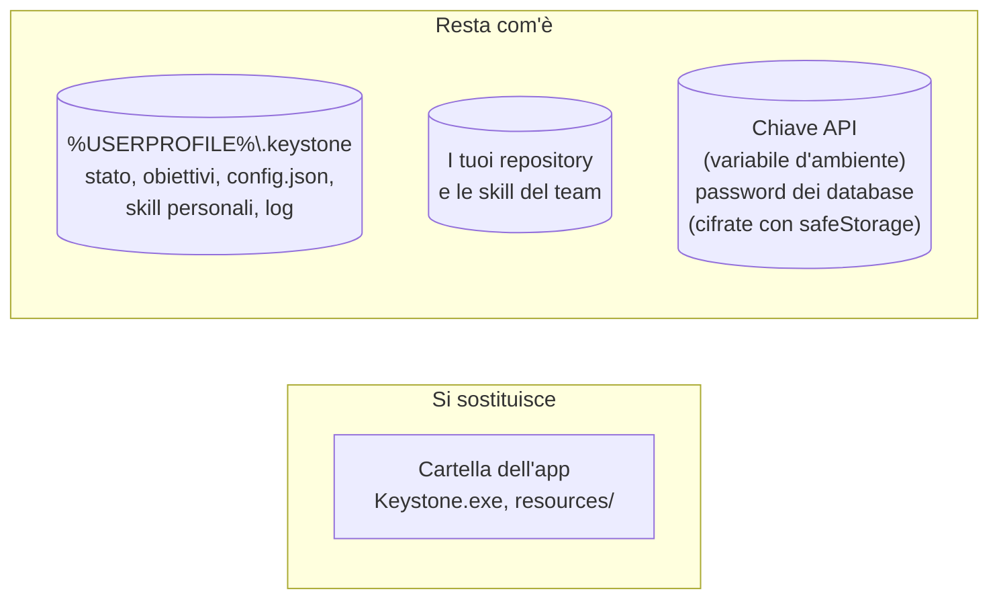

# Keystone

**Un team di agenti AI che lavora sul tuo repository git, sotto il tuo controllo.**

Keystone è un'app desktop per Windows. Gli dai un obiettivo ("aggiungi l'esportazione in CSV",
"correggi i test che falliscono") e un team di agenti, un **lead** e da uno a cinque **worker**, lo
divide in task, li esegue in parallelo e te li porta in review. Ogni agente lavora in una copia
separata del repository. Il tuo checkout cambia solo quando premi **Merge**.

---

## Come funziona


1. **Scrivi l'obiettivo** nella console in basso nell'app.
2. **Il lead lo divide in task** e li assegna ai worker. Puoi vederli nel tabellone.
3. **Ogni worker lavora nel suo worktree**, su un branch suo (`Keystone/<agente>/<task>`). Gli
   agenti non toccano mai i tuoi file.
4. **Keystone esegue i test e la verifica visuale**: li esegue Keystone, non l'agente, così il
   risultato è una prova indipendente.
5. **La review si apre sul riassunto**: cosa è stato chiesto, cosa è stato fatto e perché, i file
   toccati, l'esito dei test, le schermate prima/dopo e i rischi. Il diff sta in una scheda a parte.
6. **Decidi tu**: `Merge`, `Richiedi modifiche` oppure `Rifiuta`.

### Le parti dell'app



- **L'app** è solo la finestra: mostra lo stato e invia i tuoi comandi.
- **L'orchestratore** possiede tutto lo stato, applica le regole e guida gli agenti. Se chiudi la
  finestra gli agenti continuano a lavorare; quando la riapri, l'app si ricollega da sola.
- **I dati** (stato, log, schermate, trascrizioni) stanno in `%USERPROFILE%\.keystone`, mai nel
  repository.

### Cosa un agente non può fare



- **Tutto ciò che non è consentito chiede a te.** Le azioni su percorsi protetti vengono negate e
  basta.
- **Niente push.** Lo blocca git stesso, su più livelli indipendenti, e gli agenti non hanno
  credenziali.
- **Le chiavi non arrivano agli agenti**: non sono nei loro comandi, nei log o nelle trascrizioni.
- **Il merge è atomico**: non lascia mai il tuo checkout a metà.
- **Nessuna configurazione personale**: gli agenti non ereditano impostazioni, hook, server MCP,
  memoria o `CLAUDE.md` del tuo Claude Code.

I dettagli e i limiti ("non è una sandbox") sono in [`docs/sicurezza.md`](docs/sicurezza.md).

---

## Installazione

Keystone si distribuisce come **app portabile**: una cartella con `Keystone.exe`. Non c'è un
installatore e non servono né Node né i sorgenti.

### Requisiti

| | |
|---|---|
| Sistema | Windows 10 o 11, 64 bit |
| Git | [Git for Windows](https://git-scm.com/download/win) installato e nel `PATH` |
| Spazio | circa 750 MB per l'app, più lo spazio per i worktree degli agenti |
| Modello | una chiave API Anthropic (oppure Bedrock, Vertex, Foundry). Senza chiave c'è il motore **sim**, per provare il flusso |

### Passi



**1. Scarica** `Keystone-<versione>-win32-x64.zip` dalla pagina
[Releases](https://github.com/yokxi/Keystone/releases) del repository.

**2. Estrai lo zip** in una cartella che usi solo tu, per esempio
`%LOCALAPPDATA%\Programs\Keystone`. Evita cartelle condivise o di rete: chi può scrivere nella
cartella dell'app può modificarla.

**3. Imposta la chiave API** come variabile d'ambiente del tuo utente:

```powershell
setx ANTHROPIC_API_KEY "sk-ant-..."
```

Poi chiudi e riapri le finestre da cui avvii Keystone, perché la variabile valga. Keystone passa la
chiave solo al motore, non ai comandi degli agenti. Per Bedrock, Vertex o Foundry vedi
[`docs/motore-claude.md`](docs/motore-claude.md).

**4. Scegli il motore.** Senza configurazione Keystone usa il motore **sim**, che simula gli agenti
e non consuma nulla: è utile per una prima prova. Per gli agenti veri crea
`%USERPROFILE%\.keystone\config.json`:

```json
{
  "engine": "claude",
  "workers": 2,
  "budgetUsd": 5
}
```

`budgetUsd` è il tetto di spesa per obiettivo, in dollari. Tutte le chiavi sono in
[`docs/configurazione.md`](docs/configurazione.md). Se il file contiene un errore, l'app lo mostra
all'avvio invece di partire con valori diversi da quelli che hai scritto.

**5. Avvia `Keystone.exe`.** L'app non è firmata digitalmente, quindi al primo avvio Windows
SmartScreen mostra "Windows ha protetto il PC": scegli **Ulteriori informazioni → Esegui
comunque**. Nell'app premi **Avvia orchestratore**.

**6. Registra il repository** dalla pagina **Repository → Registra repository**. Keystone ti
mostra prima la riga che aggiungerà al `.git/config` del repository (il guardiano che blocca il
push dagli agenti), e la scrive solo dopo la tua conferma.

Ora puoi scrivere il primo obiettivo nella console.

### Facoltativo

- **Verifica visuale** (schermate prima/dopo nella review): in **Repository → Verifica visuale →
  Configura** indichi il comando che avvia la tua app web e il suo URL locale. Al primo uso Keystone
  ti chiede il permesso di scaricare Chromium in `~/.keystone`. Vedi
  [`docs/verifica-visuale.md`](docs/verifica-visuale.md).
- **Skill**: regole in markdown per gli agenti, del repository (`.keystone/skills/`, condivise con
  git) o personali. Vedi [`docs/skill.md`](docs/skill.md).
- **Database in sola lettura** (sperimentale per PostgreSQL e SQL Server): vedi
  [`docs/database.md`](docs/database.md). Usa solo database di sviluppo o con dati anonimizzati,
  perché i risultati delle query vengono inviati al fornitore del modello.

---

## Aggiornamenti

**Gli aggiornamenti sono manuali.** Questa versione non ha l'aggiornamento automatico, che arriverà
insieme all'installatore. Keystone non si collega a internet per cercare versioni nuove.

Aggiornare significa **sostituire la cartella dell'app**. I tuoi dati restano dove sono, perché
stanno fuori dalla cartella dell'app:



### Come aggiornare

1. **Controlla le novità** nella pagina [Releases](https://github.com/yokxi/Keystone/releases). Per
   ricevere un avviso a ogni versione nuova: **Watch → Custom → Releases** sul repository GitHub.
2. **Aspetta che gli agenti abbiano finito**, oppure metti in pausa l'obiettivo con `/pausa`.
3. **Chiudi l'app e l'orchestratore.** L'orchestratore gira anche a finestra chiusa: in Gestione
   attività chiudi tutti i processi **Keystone**.
4. **Scarica ed estrai il nuovo zip** in una cartella nuova, per esempio
   `Keystone-0.2.0`. Tieni la vecchia finché non hai verificato che la nuova funziona.
5. **Avvia il nuovo `Keystone.exe`** e premi **Avvia orchestratore**. Ritrovi obiettivi, task,
   memoria e repository registrati: lo stato viene completato da solo con i campi nuovi.
6. Se va tutto bene, **cancella la vecchia cartella**. Se qualcosa non va, chiudi tutto e riavvia la
   vecchia versione.

Lo stato si salva con una copia di sicurezza (`state.json.bak`) a ogni scrittura. Prima di un
aggiornamento puoi comunque copiare la cartella `%USERPROFILE%\.keystone\<profilo>`, per sicurezza.

---

## Motori

| Motore | Stato | Documentazione |
|---|---|---|
| Sim | simulato, senza API: per provare il flusso | — |
| Claude | Claude Agent SDK, con chiave API o provider cloud | [`docs/motore-claude.md`](docs/motore-claude.md) |
| Codex | **non incluso in questa versione**: arriva dopo la prova con un modello reale | [`docs/motore-codex.md`](docs/motore-codex.md) |

Modelli predefiniti: **Claude Opus 5.5** per il lead e **Claude Sonnet 5.5** per i worker. Si
cambiano in `config.json` (`leadModel`, `workerModel`, oppure per singolo agente).

---

## Sviluppo

Serve Node 22 o successivo.

```powershell
npm install
npm run orchestrator -- --demo        # team simulato su un repository di prova
npm run app                           # l'interfaccia (in un altro terminale)
```

Con un motore vero: `--engine claude`. Tutte le opzioni: `npm run orchestrator -- --help`.

Per creare l'app portabile:

```powershell
npm run package -w app -- --zip       # app/release/Keystone-<versione>-win32-x64.zip
```

Dettagli in [`docs/pacchetto.md`](docs/pacchetto.md).

---

## Documenti

| Documento | Contenuto |
|---|---|
| [`docs/sicurezza.md`](docs/sicurezza.md) | cosa può e non può fare un agente, e i limiti |
| [`docs/interfaccia.md`](docs/interfaccia.md) | le pagine dell'app |
| [`docs/configurazione.md`](docs/configurazione.md) | il file `~/.keystone/config.json` |
| [`docs/motore-claude.md`](docs/motore-claude.md) | il motore Claude: autenticazione, modelli, spesa |
| [`docs/verifica-visuale.md`](docs/verifica-visuale.md) | le schermate prima/dopo nella review |
| [`docs/skill.md`](docs/skill.md) | le regole in markdown per gli agenti |
| [`docs/database.md`](docs/database.md) | l'accesso ai database, in sola lettura |
| [`docs/pacchetto.md`](docs/pacchetto.md) | l'app portabile e come avvia l'orchestratore |
| [`docs/protocol.md`](docs/protocol.md) | il protocollo tra orchestratore e app |
| [`docs/piano.md`](docs/piano.md) | le fasi successive |
