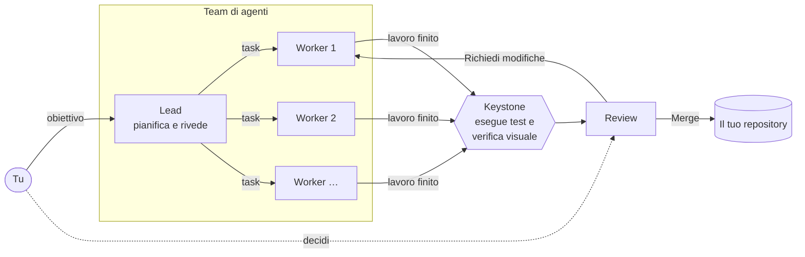
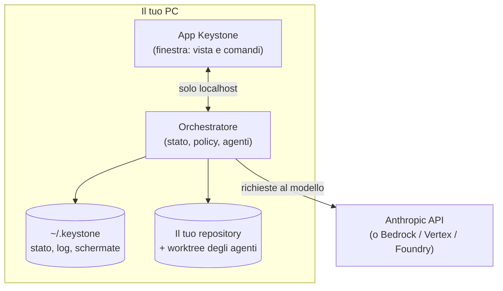
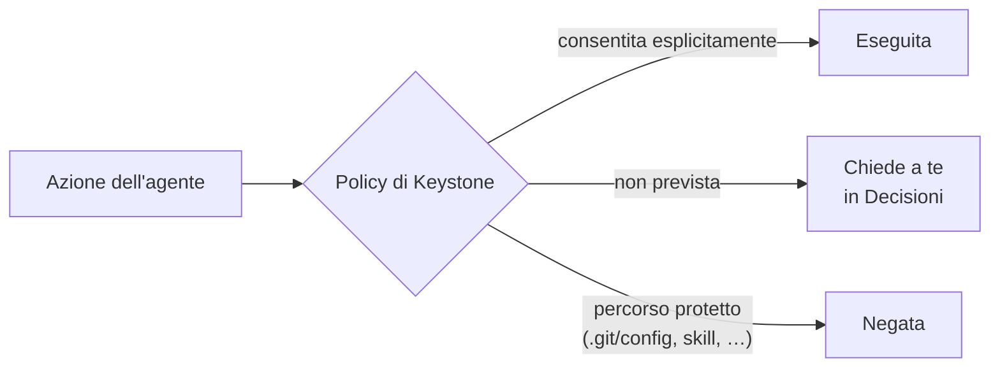
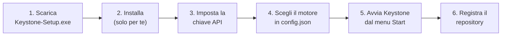
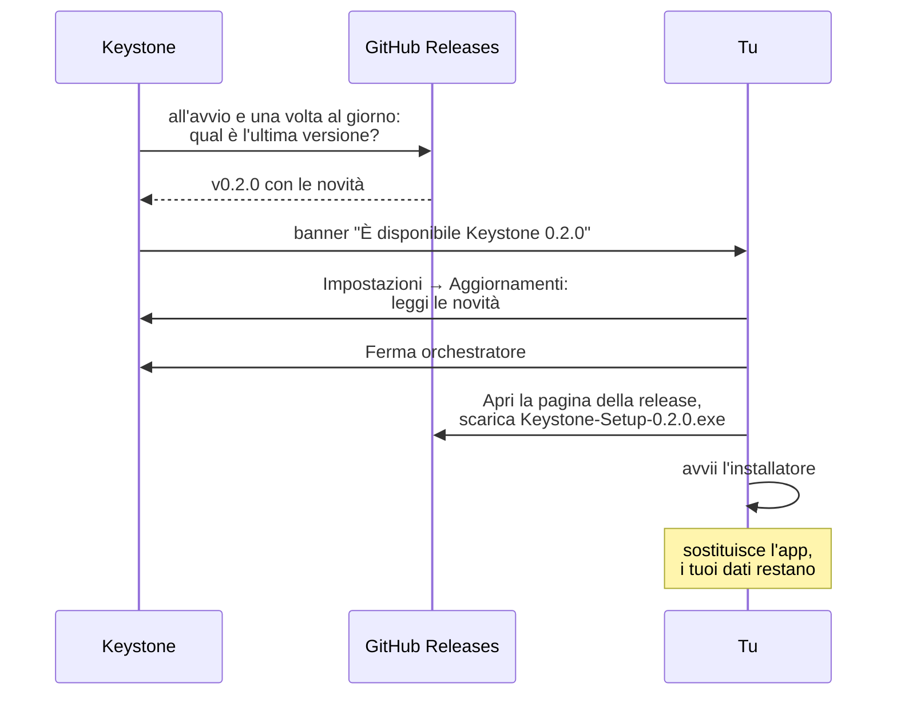
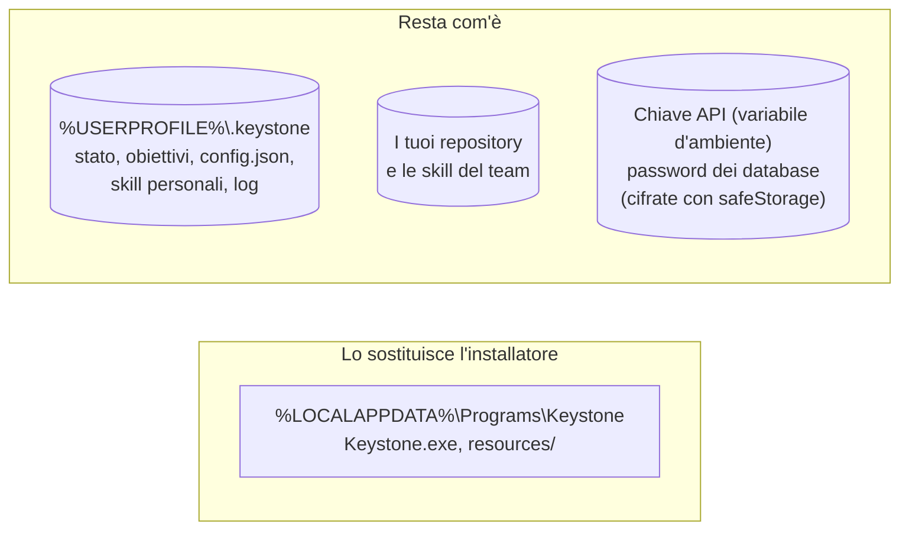

# Keystone

**Un team di agenti AI che lavora sul tuo repository git, sotto il tuo controllo.**

Keystone è un'app desktop per Windows. Gli dai un obiettivo ("aggiungi l'esportazione in CSV",
"correggi i test che falliscono") e un team di agenti, un **lead** e da uno a cinque **worker**, lo
divide in task, li esegue in parallelo e te li porta in review. Ogni agente lavora in una copia
separata del repository. Il tuo checkout cambia solo quando premi **Merge**.

---

## Come funziona



1. **Scrivi l'obiettivo** nella console in basso nell'app.
2. **Il lead lo divide in task** e li assegna ai worker. Puoi vederli nel tabellone.
3. **Ogni worker lavora nel suo worktree**, su un branch suo (`Keystone/<agente>/<task>`). Gli
   agenti non toccano mai i tuoi file.
4. **Keystone esegue i test e la verifica visuale**: li esegue Keystone, non l'agente, così il
   risultato è una prova indipendente.
5. **La review si apre sul riassunto**: cosa è stato chiesto, cosa è stato fatto e perché, i file
   toccati, l'esito dei test, le schermate prima/dopo e i rischi. Il diff sta in una scheda a parte.
6. **Decidi tu**: `Merge`, `Richiedi modifiche` oppure `Rifiuta`.

### Le parti dell'app



- **L'app** è solo la finestra: mostra lo stato e invia i tuoi comandi.
- **L'orchestratore** possiede tutto lo stato, applica le regole e guida gli agenti. Se chiudi la
  finestra gli agenti continuano a lavorare; quando la riapri, l'app si ricollega da sola.
- **I dati** (stato, log, schermate, trascrizioni) stanno in `%USERPROFILE%\.keystone`, mai nel
  repository.

### Cosa un agente non può fare



- **Tutto ciò che non è consentito chiede a te.** Le azioni su percorsi protetti vengono negate e
  basta.
- **Niente push.** Lo blocca git stesso, su più livelli indipendenti, e gli agenti non hanno
  credenziali.
- **Le chiavi non arrivano agli agenti**: non sono nei loro comandi, nei log o nelle trascrizioni.
- **Il merge è atomico**: non lascia mai il tuo checkout a metà.
- **Nessuna configurazione personale**: gli agenti non ereditano impostazioni, hook, server MCP,
  memoria o `CLAUDE.md` del tuo Claude Code.

I dettagli e i limiti ("non è una sandbox") sono in [`docs/sicurezza.md`](docs/sicurezza.md).

---

## Installazione

Keystone si installa con **`Keystone-Setup-<versione>.exe`**, un installatore classico di Windows.
Non servono permessi di amministratore, né Node, né i sorgenti.

### Requisiti

| | |
|---|---|
| Sistema | Windows 10 o 11, 64 bit |
| Git | [Git for Windows](https://git-scm.com/download/win) installato e nel `PATH` |
| Spazio | circa 750 MB per l'app, più lo spazio per i worktree degli agenti |
| Modello | una chiave API Anthropic (oppure Bedrock, Vertex, Foundry). Senza chiave c'è il motore **sim**, per provare il flusso |

### Passi



**1. Scarica** `Keystone-Setup-<versione>.exe` dalla pagina
[Releases](https://github.com/yokxi/Keystone/releases). Accanto c'è il file `.sha256` con
l'impronta: per controllarla, in PowerShell:

```powershell
Get-FileHash .\Keystone-Setup-0.1.0.exe -Algorithm SHA256
```

**2. Avvia l'installatore.** L'app non è firmata digitalmente, quindi Windows SmartScreen mostra
"Windows ha protetto il PC": scegli **Ulteriori informazioni → Esegui comunque**. L'installatore:

- mette l'app in `%LOCALAPPDATA%\Programs\Keystone`, per il solo tuo utente;
- crea il collegamento nel menu Start (e, se lo scegli nell'ultima pagina, sul desktop);
- registra Keystone in **Impostazioni → App → App installate**, da dove si disinstalla.

**3. Imposta la chiave API** come variabile d'ambiente del tuo utente:

```powershell
setx ANTHROPIC_API_KEY "sk-ant-..."
```

Poi esci e rientra in Windows (o almeno riavvia Keystone), perché la variabile valga. Keystone passa
la chiave solo al motore, non ai comandi degli agenti. Per Bedrock, Vertex o Foundry vedi
[`docs/motore-claude.md`](docs/motore-claude.md).

**4. Scegli il motore.** Senza configurazione Keystone usa il motore **sim**, che simula gli agenti
e non consuma nulla: è utile per una prima prova. Per gli agenti veri crea
`%USERPROFILE%\.keystone\config.json`:

```json
{
  "engine": "claude",
  "workers": 2,
  "budgetUsd": 5
}
```

`budgetUsd` è il tetto di spesa per obiettivo, in dollari. Tutte le chiavi sono in
[`docs/configurazione.md`](docs/configurazione.md). Se il file contiene un errore, l'app lo mostra
all'avvio invece di partire con valori diversi da quelli che hai scritto.

**5. Avvia Keystone** dal menu Start e premi **Avvia orchestratore**.

**6. Registra il repository** dalla pagina **Repository → Registra repository**. Keystone ti
mostra prima la riga che aggiungerà al `.git/config` del repository (il guardiano che blocca il
push dagli agenti), e la scrive solo dopo la tua conferma.

Ora puoi scrivere il primo obiettivo nella console.

> **Senza installatore.** Nella stessa release c'è anche lo zip portabile
> (`Keystone-<versione>-win32-x64.zip`): lo estrai in una cartella tua e avvii `Keystone.exe`.
> L'app è la stessa; cambia solo che non ci sono collegamenti né voce in "App installate".

### Facoltativo

- **Verifica visuale** (schermate prima/dopo nella review): in **Repository → Verifica visuale →
  Configura** indichi il comando che avvia la tua app web e il suo URL locale. Al primo uso Keystone
  ti chiede il permesso di scaricare Chromium in `~/.keystone`. Vedi
  [`docs/verifica-visuale.md`](docs/verifica-visuale.md).
- **Skill**: regole in markdown per gli agenti, del repository (`.keystone/skills/`, condivise con
  git) o personali. Vedi [`docs/skill.md`](docs/skill.md).
- **Database in sola lettura** (sperimentale per PostgreSQL e SQL Server): vedi
  [`docs/database.md`](docs/database.md). Usa solo database di sviluppo o con dati anonimizzati,
  perché i risultati delle query vengono inviati al fornitore del modello.

### Disinstallazione

Da **Impostazioni → App → App installate → Keystone → Disinstalla**. Prima ferma l'orchestratore
(in Keystone: **Impostazioni → Ferma orchestratore**). La disinstallazione toglie solo i file
dell'app: i tuoi dati in `%USERPROFILE%\.keystone` restano, e li cancelli a mano se non ti servono
più. I tuoi repository non vengono toccati; per togliere il guardiano dal loro `.git/config` vedi
[`docs/sicurezza.md`](docs/sicurezza.md).

---

## Aggiornamenti

Keystone **ti avvisa** quando esce una versione nuova, ma **non scarica e non installa nulla da
solo**: l'ultima parola è tua.



### Come aggiornare

1. Quando compare il banner **"È disponibile Keystone x.y.z"**, apri **Impostazioni →
   Aggiornamenti** e leggi le novità.
2. **Aspetta che gli agenti abbiano finito**, poi premi **Ferma orchestratore**. L'orchestratore
   salva lo stato ed esce. Se qualche agente sta lavorando, Keystone te lo dice prima: i turni
   interrotti riprendono al prossimo avvio.
3. Chiudi la finestra di Keystone.
4. Premi **Apri la pagina della release** (si apre nel browser), scarica
   `Keystone-Setup-x.y.z.exe` e avvialo. L'installatore toglie la versione vecchia e mette la
   nuova nella stessa cartella. Se Keystone è ancora in esecuzione, te lo dice e aspetta.
5. Riapri Keystone e premi **Avvia orchestratore**: ritrovi obiettivi, task, memoria, skill e
   repository registrati.

### Cosa cambia e cosa resta



Lo stato si salva con una copia di sicurezza (`state.json.bak`) a ogni scrittura, e la versione
nuova lo completa da sola con i campi che mancavano. Prima di un aggiornamento puoi comunque
copiare la cartella `%USERPROFILE%\.keystone`, per sicurezza. Per tornare alla versione precedente
basta installare il suo `Keystone-Setup` dalla pagina Releases.

### Il controllo degli aggiornamenti

- Contatta **solo** `api.github.com`, con una richiesta anonima: non manda dati su di te, sul PC o
  sui tuoi repository. È l'unica richiesta di rete che Keystone fa da solo.
- Si spegne in **Impostazioni → Aggiornamenti** (casella "Controlla gli aggiornamenti"). Da lì
  puoi anche controllare a mano con **Controlla ora**. Con la variabile `KEYSTONE_NO_UPDATE_CHECK=1`
  è spento del tutto.
- Per ricevere anche un'email a ogni versione: sul repository GitHub, **Watch → Custom →
  Releases**.
- L'installatore non è firmato: l'impronta `.sha256` ti dice che il file non si è rovinato, non chi
  l'ha pubblicato. Scaricalo solo dalla pagina Releases di `yokxi/Keystone`. Dettagli in
  [`docs/sicurezza.md`](docs/sicurezza.md) ("Aggiornamenti").

---

## Motori

| Motore | Stato | Documentazione |
|---|---|---|
| Sim | simulato, senza API: per provare il flusso | — |
| Claude | Claude Agent SDK, con chiave API o provider cloud | [`docs/motore-claude.md`](docs/motore-claude.md) |
| Codex | **non incluso in questa versione**: arriva dopo la prova con un modello reale | [`docs/motore-codex.md`](docs/motore-codex.md) |

Modelli predefiniti: **Claude Opus 5.5** per il lead e **Claude Sonnet 5.5** per i worker. Si
cambiano in `config.json` (`leadModel`, `workerModel`, oppure per singolo agente).

---

## Sviluppo

Serve Node 22 o successivo.

```powershell
npm install
npm run orchestrator -- --demo        # team simulato su un repository di prova
npm run app                           # l'interfaccia (in un altro terminale)
```

Con un motore vero: `--engine claude`. Tutte le opzioni: `npm run orchestrator -- --help`.

Per creare l'installatore e lo zip portabile (serve NSIS 3, vedi [`docs/pacchetto.md`](docs/pacchetto.md)):

```powershell
npm run installer -w app -- --zip     # app/release/Keystone-Setup-<versione>.exe, .sha256 e lo zip
```

Come si pubblica una versione nuova: [`docs/pacchetto.md`](docs/pacchetto.md), "Aggiornamenti".

---

## Documenti

| Documento | Contenuto |
|---|---|
| [`docs/sicurezza.md`](docs/sicurezza.md) | cosa può e non può fare un agente, e i limiti |
| [`docs/interfaccia.md`](docs/interfaccia.md) | le pagine dell'app |
| [`docs/configurazione.md`](docs/configurazione.md) | il file `~/.keystone/config.json` |
| [`docs/motore-claude.md`](docs/motore-claude.md) | il motore Claude: autenticazione, modelli, spesa |
| [`docs/verifica-visuale.md`](docs/verifica-visuale.md) | le schermate prima/dopo nella review |
| [`docs/skill.md`](docs/skill.md) | le regole in markdown per gli agenti |
| [`docs/database.md`](docs/database.md) | l'accesso ai database, in sola lettura |
| [`docs/pacchetto.md`](docs/pacchetto.md) | installatore, app portabile, pubblicazione delle versioni |
| [`docs/protocol.md`](docs/protocol.md) | il protocollo tra orchestratore e app |
| [`docs/piano.md`](docs/piano.md) | le fasi successive |
